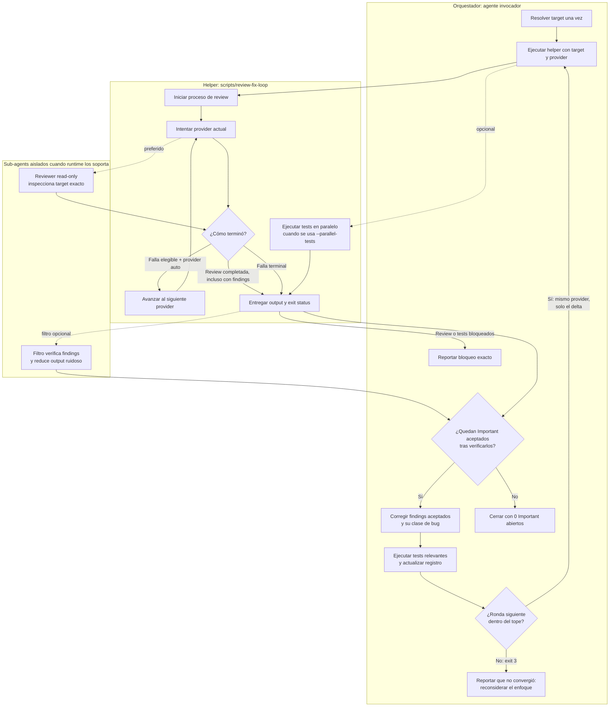

# Review Fix Loop

Run a code review as a closeout check. Select the first available provider in this order:

1. Claude + Copilot API con Luna y esfuerzo max
2. Claude directo
3. Codex

This is code review, not Guardian `auto_review` approval routing.

Use when:
- user asks for Codex review, autoreview, or a second-model review
- after non-trivial code edits, before final/commit/ship
- reviewing a local branch or PR branch after fixes

## Contract

- Treat review output as advisory. Never blindly apply it.
- Verify every finding by reading the real code path and adjacent files.
- Read dependency docs/source/types when a finding depends on external behavior.
- Reject unrealistic edge cases, speculative risks, broad rewrites, and fixes that over-complicate the codebase.
- Prefer small fixes at the right ownership boundary; no refactor unless it clearly improves the bug class.
- Read [política de convergencia](../../../(code-quality)/references/review-convergence.md) before the first round. It defines the round cap, delta re-review, findings ledger, bug-class fixes, and what blocks. If the relative link does not resolve because the skill is installed as a symlink, resolve the skill directory's real path first (`realpath`/`Get-Item .Target`).
- Keep going until every launched review process exits and the completed review leaves no open `Important` finding, or until the round cap stops the loop.
- When a provider reports accepted `Important` findings, enter the mandatory loop: review -> verify findings -> fix accepted findings and every instance of their bug class inside the target -> run relevant tests -> record outcomes in the ledger -> rerun the same provider on the delta -> repeat.
- **Round cap**: at most 3 rounds (`--max-rounds`). When the helper exits `3`, stop: report that the loop did not converge, list open findings, and recommend reconsidering the approach. Never present that state as clean.
- `Nit` and `Pre-existing` findings never trigger another round by themselves. Fix cheap local nits in the same round; list the rest as follow-up in the final report.
- Never stop after reporting findings with a passive closeout such as "No hice cambios; esto fue solo review." Fix accepted findings unless the user explicitly asks for review-only or forbids changes.
- If every finding is rejected after verification, document the rejection reason in the ledger. Rerun only when code or review target changed.
- If a review-triggered fix changes code, rerun focused tests and review the updated target.
- Do not push just to review. Push only when the user requested push/ship/PR update.

## Arquitectura y bucle de feedback



Límites de responsabilidad:

- Agente orquestador controla verificación de findings, correcciones, tests relevantes y terminación del loop.
- Helper controla ejecución de target/provider, fallback elegible secuencial, tests paralelos opcionales y exit status de procesos.
- Sub-agents de reviewer y filtro son capacidades opcionales del runtime; procesos CLI de providers son adapters, no sub-agents nativos.
- Exit `0` del provider significa que review terminó. Solo output verificado con `0` findings aceptados o accionables significa loop limpio.

## Provider Selection

The bundled helper supports:

```bash
scripts/review-fix-loop --provider auto
scripts/review-fix-loop -p claude-copilot
scripts/review-fix-loop -p claude
scripts/review-fix-loop -p codex
```

El default es `auto`: prueba Claude + Copilot API con gpt-6-luna/max, luego Claude directo y después Codex.

Do not ask which provider to use by default. A closeout check must remain non-interactive. If the user explicitly names a provider or passes `--provider/-p`, run only that provider and report a provider failure without fallback.

### Eligible fallback failures

Advance to the next provider only when the current provider could not perform the review because of:

- missing or non-executable provider binary
- authentication failure, expired credentials, or login required
- quota, rate limit, depleted credits, billing limit, or workspace `spend cap`
- infrastructure, network, timeout, TLS/DNS, overloaded, or service-unavailable errors

### Never fallback for

- a completed review with findings
- rejected or uncertain findings
- failed tests
- invalid review target or arguments
- malformed/unclassified provider output
- an unknown provider error
- a target that changed while review/tests were running

Fallback is recovery, not a second opinion. Never launch another provider after one completed a review.

After a provider completes, keep it for review reruns. If that provider later fails for an eligible reason, continue from the next provider in the order; do not restart from Claude.

### Provider diagnostics

Treat connector, model-selection, deprecation, or plugin warnings as diagnostics when provider completes a valid review. Do not trigger fallback from diagnostics alone. Include them briefly in final report only when they can affect review coverage or provider selection.

## Provider Adapters

Read [provider adapters](references/provider-adapters.md) before manually invoking or changing provider commands. Prefer a read-only isolated subagent when runtime supports one; otherwise use bundled helper.

### Claude review profiles

`claude-copilot` va primero. El helper fija endpoint, dummy token, modelos gpt-6-luna con esfuerzo max, flags del provider y timeout MCP. No hereda variables de Copilot API desde settings del usuario. También define `CLAUDE_CODE_SUBAGENT_MODEL=gpt-6-luna[1m]` para que cada subagente use Luna.

`claude` usa conexión directa: limpia variables Anthropic de Copilot API y carga solo settings de proyecto/locales. No hereda perfil Luna/Copilot de `claude-copilot`.

## Pick Target Once

Resolve one target before selecting a provider. Every fallback must review that same target; do not let each provider recalculate scope independently.

Dirty local work:

```bash
<skill-root>/scripts/review-fix-loop --mode local
```

Use local mode only when the patch is actually staged, unstaged, or untracked. A clean local review proves nothing about committed branch work.

Branch/PR work:

```bash
git fetch origin
base=$(gh pr view --json baseRefName --jq .baseRefName)
<skill-root>/scripts/review-fix-loop --mode branch --base "origin/$base"
```

Without an open PR, the helper uses `origin/main` for a non-main branch.

Round 2 onward (delta re-review). Right before applying each round's fixes, snapshot the current state; the next round reviews only what changed after it:

```bash
# Antes de aplicar los fixes de la ronda. `git stash create` guarda el working tree
# tracked como commit sin tocar el árbol; sin cambios devuelve vacío y se usa HEAD.
round_start=$(git stash create); round_start=${round_start:-$(git rev-parse HEAD)}
# ...aplicar fixes y correr tests...
<skill-root>/scripts/review-fix-loop --since "$round_start" --round 2 \
  --known-findings "$ledger_file"
```

The snapshot does not include untracked files, so a fix that creates a new file still shows as an untracked file in the delta review. `codex review --base` compares commits only: with Codex, commit the round's fixes before the delta review, or fall back to the full target and drop findings already in the ledger.

The ledger file is plain text with one line per triaged finding (`archivo:línea · clase · etiqueta · resultado · motivo`). Keep it in the session scratchpad, not in the repository. Codex does not accept extra instructions together with `--base`, so with Codex the orchestrator drops repeated findings by comparing against the ledger.

Committed single change with direct Codex:

```bash
codex review --commit HEAD
```

## Parallel Closeout

Format first if formatting can change line locations. Then tests and review may run in parallel:

```bash
<skill-root>/scripts/review-fix-loop --parallel-tests "<focused test command>"
```

The review side may perform sequential provider fallbacks while tests run once. Failed tests do not trigger provider fallback. If tests or review lead to edits, rerun affected tests and review the updated target.

When exact target already has relevant passing test evidence from current task and no files changed afterward, reuse that evidence instead of rerunning tests in parallel. Record command and result in final report.

## Context Efficiency

Provider output is usually noisy. Use isolated read-only filter only when runtime supports native subagents. Otherwise evaluate provider output directly. The filter acts as the adversarial verifier: it tries to refute each finding by reading the code. Ask filter to return only:

- actionable findings it accepts, with label (`Important`, `Nit`, `Pre-existing`) and bug class
- findings it rejects, with one-line reason
- findings already in the ledger, so they are not reopened
- exact files/tests to rerun

The filter must not invoke this skill or another provider. Run inline only for tiny changes or when subagents are unavailable.

## Long-Running Reviews

- Start exactly one provider attempt at a time.
- Wait for the selected command and every child process it launches to finish before fallback or closeout.
- Do not start the next provider while the previous process tree is alive.
- When a review stays quiet long enough that the user could think it hung, inspect the provider process tree and send a brief progress update (elapsed time, what is still running). Report again at meaningful milestones (provider finished, fallback, tests done) rather than on a fixed interval, so the user knows the loop is alive without noise.
- Do not terminate a review only because it becomes quiet; long silences are normal for providers. Only helper/provider/host timeout counts as eligible fallback failure.
- Repeated plugin warnings, validation chatter, or lack of a final clean line are not success evidence.
- A run is clean only after all launched processes exit and verified review output contains 0 accepted/actionable findings.
- Never present a self-interrupted review as a clean or responsible partial closeout. If the environment terminates it, report the contract as unsatisfied.

## Helper

Bundled helper:

```bash
<skill-root>/scripts/review-fix-loop --help
```

The helper:

- accepts `-p/--provider auto|claude-copilot|claude|codex`
- chooses dirty local work first, otherwise PR/current branch
- uses the current PR base when available, otherwise `origin/main`
- supports binary overrides with `--claude-bin` and `--codex-bin`
- supports `--output`, `--parallel-tests`, and `--dry-run`
- supports `--timeout-seconds` (default 600; `0` disables timeout; enabled timeout requires `python3`)
- supports `--since REF` for delta re-review, `--round N` / `--max-rounds N` (default 3, or `REVIEW_FIX_LOOP_MAX_ROUNDS`) and `--known-findings FILE`
- exits `3` without running a provider when the round exceeds the cap
- asks the provider to read `REVIEW.md`/`CLAUDE.md`/`AGENTS.md`, check PR intent and root cause, label findings, report bug class, and start with the finding count
- prints the provider that completed and every fallback cause
- treats unclassified provider failures as terminal instead of silently falling back

A successful provider process means the review completed, not automatically that it was clean. Verify its output before closeout.

## Final Report

Start with the finding count per label, as the shared review contract requires. Include:

- rounds used out of the cap, and whether the loop converged or stopped at the cap
- provider that completed the final review
- failed provider attempts and exact fallback reasons
- provider diagnostics that materially affected coverage, or `none`
- review command/surface and target used
- tests/proof run
- findings accepted/rejected, briefly why
- open `Nit` and `Pre-existing` findings left as follow-up
- final clean result after all launched processes exited, or exact blocker

Do not run another provider solely to improve final wording, obtain a second opinion, or get a nicer clean line.
